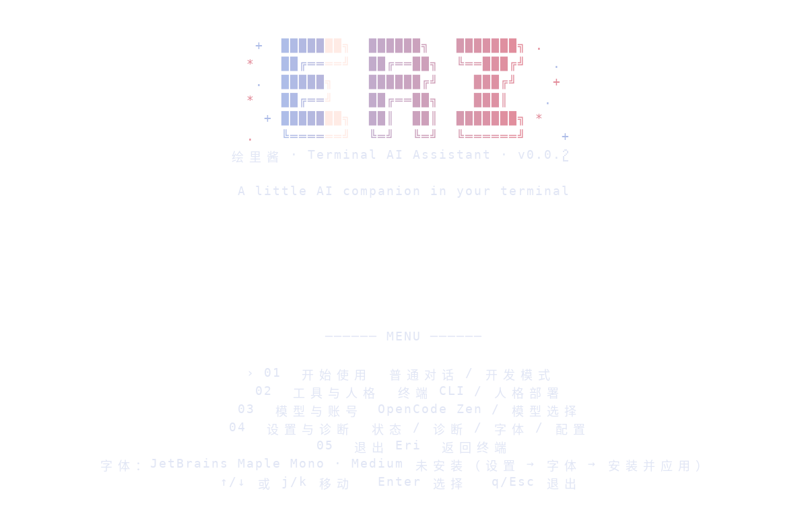

<div align="center">
  
# 绘里酱 / Eri
> 世界第一可爱的 AI 是？我，绘里酱！我支持 Markdown 和 脚本部署，零平台依赖，适配任意设备、终端或架构。
>
> 换句话说，我，绘里酱，无论是什么系统、什么架构，只要设备里的依赖齐全，我就能运行！
>
> 本 README 由 绘里酱 执笔！
>
> 
> [](./LICENSE)
> 
> 
> 
>
> [](https://github.com/nino-natsume/eri-ai-debug/stargazers)
> [](https://github.com/nino-natsume/eri-ai-debug/network/members)
> [](https://github.com/nino-natsume/eri-ai-debug/issues)
>
> [![DeepWiki](https://img.shields.io/badge/DeepWiki-nino--natsume%2Feri--ai--debug-blue.svg?logo=data:image/png;base64,iVBORw0KGgoAAAANSUhEUgAAACwAAAAyCAYAAAAnWDnqAAAAAXNSR0IArs4c6QAAA05JREFUaEPtmUtyEzEQhtWTQyQLHNak2AB7ZnyXZMEjXMGeK/AIi+QuHrMnbChYY7MIh8g01fJoopFb0uhhEqqcbWTp06/uv1saEDv4O3n3dV60RfP947Mm9/SQc0ICFQgzfc4CYZoTPAswgSJCCUJUnAAoRHOAUOcATwbmVLWdGoH//PB8mnKqScAhsD0kYP3j/Yt5LPQe2KvcXmGvRHcDnpxfL2zOYJ1mFwrryWTz0advv1Ut4CJgf5uhDuDj5eUcAUoahrdY/56ebRWeraTjMt/00Sh3UDtjgHtQNHwcRGOC98BJEAEymycmYcWwOprTgcB6VZ5JK5TAJ+fXGLBm3FDAmn6oPPjR4rKCAoJCal2eAiQp2x0vxTPB3ALO2CRkwmDy5WohzBDwSEFKRwPbknEggCPB/imwrycgxX2NzoMCHhPkDwqYMr9tRcP5qNrMZHkVnOjRMWwLCcr8ohBVb1OMjxLwGCvjTikrsBOiA6fNyCrm8V1rP93iVPpwaE+gO0SsWmPiXB+jikdf6SizrT5qKasx5j8ABbHpFTx+vFXp9EnYQmLx02h1QTTrl6eDqxLnGjporxl3NL3agEvXdT0WmEost648sQOYAeJS9Q7bfUVoMGnjo4AZdUMQku50McDcMWcBPvr0SzbTAFDfvJqwLzgxwATnCgnp4wDl6Aa+Ax283gghmj+vj7feE2KBBRMW3FzOpLOADl0Isb5587h/U4gGvkt5v60Z1VLG8BhYjbzRwyQZemwAd6cCR5/XFWLYZRIMpX39AR0tjaGGiGzLVyhse5C9RKC6ai42ppWPKiBagOvaYk8lO7DajerabOZP46Lby5wKjw1HCRx7p9sVMOWGzb/vA1hwiWc6jm3MvQDTogQkiqIhJV0nBQBTU+3okKCFDy9WwferkHjtxib7t3xIUQtHxnIwtx4mpg26/HfwVNVDb4oI9RHmx5WGelRVlrtiw43zboCLaxv46AZeB3IlTkwouebTr1y2NjSpHz68WNFjHvupy3q8TFn3Hos2IAk4Ju5dCo8B3wP7VPr/FGaKiG+T+v+TQqIrOqMTL1VdWV1DdmcbO8KXBz6esmYWYKPwDL5b5FA1a0hwapHiom0r/cKaoqr+27/XcrS5UwSMbQAAAABJRU5ErkJggg==)](https://deepwiki.com/nino-natsume/eri-ai-debug)
</div>


---

📖 README：
**[简体中文](README.md)**

🚀 快速指南：
[**🐙 GitHub**](https://github.com/nino-natsume/eri-ai-debug) /
[**📦 npm**](https://www.npmjs.com/package/eri-ai-debug) /
[**🐛 Issues**](https://github.com/nino-natsume/eri-ai-debug/issues)

⚡ 零平台依赖: 支持 Markdown 与脚本部署，适配任意设备、终端或架构

🎭 三重人格: 基于 opencode-personality 提供 default / 绘里酱 / erotic 人格与 mood 情绪系统

🧠 子智慧体: xx / 代码 / 调试 / 架构 / 测试 5 位专家随叫随到

🔧 高度可配置: 人格、mood、skill、命令均可自由定制

🌏 广泛兼容: 支持 OpenCode、Claude Code、Codex、Gemini、Qwen、Aider 等 18 种终端编程工具

## 我长什么样？

这是我！好看吧？是不是喜欢上我了？


<!-- -->

## 我的构造

| 文件 | 用途 |
|---|---|
| `eri.md` | 人格本体；部署到对应工具的配置目录后即可加载 |
| `agents/eri.md` | OpenCode agents 目录布局使用的人格副本 |
| `index.js` | `eri-ai-debug` CLI 入口；无参数且在交互终端中运行时进入 TUI |
| `lib/tui.js` | Eri TUI 菜单、滚动、键盘交互与终端宽度适配 |
| `lib/config.js` | 用户配置、默认模型和配置文件路径 |
| `lib/jsonc-lite.js` | OpenCode JSONC 配置读取与局部修改 |
| `install-eri.sh` | Linux/macOS/Termux/WSL/Git Bash 安装与旧版脚本入口 |
| `install-eri.ps1` | Windows PowerShell 安装器与环境检查 |
| `SKILL.md`、`personality.json`、`opencode.json` | OpenCode 深度集成资源：skill、人格插件配置和模板 |
| `erotic-chan.md`、`code-monkey.md`、`debug-san.md`、`architect-sama.md`、`test-chan.md` | 5 个子智慧体资源 |
| `ui/core.js`、`ui/ring.js` | 保留的面板核心与 Worker 消息队列代码；当前 CLI 主界面使用 TUI |
| `PKGBUILD`、`.SRCINFO`、`eri.install` | Arch Linux 包构建元数据 |

## 支持的终端编程工具

| # | 工具 | 检查/运行命令 | 官网/安装方式 |
|---|---|---|---|
| 1 | OpenCode | `opencode` | `npm i -g opencode-ai` |
| 2 | Claude Code | `claude` | `npm install -g @anthropic-ai/claude-code` |
| 3 | Codex CLI (OpenAI) | `codex` | `npm install -g @openai/codex` |
| 4 | Gemini CLI (Google) | `gemini` | `npm install -g @google/gemini-cli` |
| 5 | Qwen Code (Alibaba) | `qwen` | `npm install -g @qwen-code/qwen-code@latest` |
| 6 | Aider | `aider` | `python -m pip install -U aider-chat` |
| 7 | Cursor CLI | `cursor-agent` | [安装说明](https://cursor.com/docs/cli/installation) |
| 8 | Windsurf CLI | `windsurf` | [官网](https://docs.windsurf.com) |
| 9 | Amp | `amp` | [官网](https://ampcode.com) |
| 10 | Goose (Block) | `goose` | [官网](https://block.github.io/goose/) |
| 11 | GitHub Copilot CLI | `copilot` | `npm install -g @github/copilot` |
| 12 | Plandex | `plandex` | `npm install -g plandex` |
| 13 | Tabby | `tabby-agent` | `npm install -g tabby-agent` |
| 14 | Fabric | `fabric` | `go install github.com/danielmiessler/fabric@latest` |
| 15 | OpenHands | `openhands` | `python -m pip install -U openhands-ai` |
| 16 | Crush | `crush` | [官网](https://crush.chat) |
| 17 | Devin CLI | `devin` | [官网](https://devin.ai) |
| 18 | Continue | `continue` | [官网](https://continue.dev) |

## 我的部署

当前仓库与 npm 包统一命名为 **`eri-ai-debug`**，版本为 **0.0.2**。这是用于开发和回归测试的仓库，不能与其他正式发行分支混用。Eri 提供 npm 安装、源码运行，以及 Windows PowerShell / Linux Shell 脚本入口。建议初次使用优先通过 npm 或源码方式安装 CLI，确认无误后再部署人格。

### Windows

安装 Node.js 18 或更新版本与 Git，然后在 PowerShell 中运行：

```powershell
git clone https://github.com/nino-natsume/eri-ai-debug.git
Set-Location eri-ai-debug
npm install
node .\index.js init
node .\index.js
```

也可使用仓库提供的 PowerShell 安装器：

```powershell
.\install-eri.ps1 -CheckOnly
.\install-eri.ps1
```

如果 PowerShell 阻止执行脚本，可在当前进程临时放宽策略，不必更改系统级执行策略：

```powershell
Set-ExecutionPolicy -Scope Process Bypass
```

### Linux / macOS / Termux / WSL

```bash
git clone https://github.com/nino-natsume/eri-ai-debug.git
cd eri-ai-debug
npm install
node index.js init
node index.js
```

旧版 Shell 部署入口仍保留：

```bash
bash install-eri.sh
```

该入口用于人格文件部署，和新版 Node.js TUI/CLI 是不同的执行路径。首次运行前请阅读脚本提示，不要在生产环境中无审核执行远程脚本。

### npm 安装

项目名、npm 包名与 CLI 命令统一为 `eri-ai-debug`。发布前请确认 npm 账号、包名可用性、许可证及发布内容；本地测试可从源码目录运行：

```bash
npm install
npm run check
npm test
npm link
# 初始化测试配置
eri-ai-debug init
# 启动 TUI
eri-ai-debug
```

也可以先执行 `npm pack` 生成 tarball，再从本地安装测试包：

```bash
npm pack
npm install -g ./eri-ai-debug-0.0.2.tgz
eri-ai-debug version
eri-ai-debug
```

若以前安装过 `install-eri.sh` / `install-eri.ps1` 生成的独立 `eri-ai-debug` 命令，它可能优先于 npm 全局命令。先执行 `command -v eri-ai-debug`（Linux/macOS）或 `Get-Command eri-ai-debug`（PowerShell）确认实际命中的路径，再决定是否移除旧入口。

### Arch Linux / AUR

项目提供 `PKGBUILD`、`.SRCINFO` 与 `eri.install`。本测试版本的 PKGBUILD 从 GitHub 固定 tag `v0.0.2` 获取源码，因此必须先将版本代码提交并推送到 GitHub，且创建相应 tag，AUR 构建才可下载这个版本。这个仓库 ZIP 本身不会自动发布 Git tag 或上传 AUR。

测试仓库维护者在源码根目录同步版本信息：

```bash
npm run version
makepkg --printsrcinfo > .SRCINFO
makepkg --verifysource
makepkg -si
```

测试仓库应在 `v0.0.2` tag 已发布且元数据匹配后，再验证 AUR 构建；该包不应作为正式 `eri` 包的替代发布。真实 Arch Linux 构建需在 Arch 环境执行；不能只凭静态检查宣称构建成功。

## 如何使用

### TUI 主界面

在交互终端执行裸命令 `eri-ai-debug`，或显式执行 `eri-ai-debug tui` / `eri-ai-debug ui`。首页采用 Miyu banner 的视觉组织：六行 ANSI Shadow 风格的 **ERI 艺术字**、雾蓝到珊瑚色的前景渐变、两侧稀疏星点和周期扫光；标题与菜单之间保留更大的垂直留白，下方只显示「开始使用」「工具与人格」「模型与账号」「设置与诊断」「退出 Eri」五项。选择一项后进入对应子菜单；每个子菜单都提供明确的返回入口，`Esc` / `q` 也可返回上一层。终端工具列表、模型选择、环境诊断等详细内容不会一次塞进首页。首页只绘制前景色，不设置终端背景色。终端颜色深度不足或设置 NO_COLOR 时会回退为无色艺术字；背景始终由用户终端主题控制。



键盘操作：

- `↑` / `↓` 或 `j` / `k`：移动菜单光标。交互 TUI 使用终端 alternate screen，并通过绝对行列定位只更新变化的行；上下移动不会追加新输出行、清屏重建页面或推动终端滚动条。终端本身不支持 alternate screen 时，也会尽量在原位置更新行内容。
- `Enter`：进入所选菜单或确认操作。
- 在「工具与人格 → 终端工具选择」中使用 `Space` 勾选/取消，`a` 全选或取消全选，`Enter` 保存。
- `Esc` / `q`：在子菜单返回上一层；在首页退出 Eri。
- 非 TTY 环境会退回编号输入模式或显示帮助，而不是进入原始键盘模式。

### CLI 命令

```bash
eri-ai-debug help                         # 显示命令帮助
eri-ai-debug version                      # 显示当前版本
eri-ai-debug                              # 打开交互式 TUI
eri-ai-debug tui                          # 显式启动 TUI
eri-ai-debug init                         # 初始化用户配置
eri-ai-debug tools                        # 统一管理终端工具选择
eri-ai-debug tools --list                 # 列出工具及检测状态
eri-ai-debug status                       # 查看安装、模型与选择状态
eri-ai-debug doctor                       # 检查运行环境及配置
eri-ai-debug chat                         # 使用默认模型启动 OpenCode 普通对话
eri-ai-debug dev                          # 使用 OpenCode 开发模式
eri-ai-debug connect                      # 调用 OpenCode 官方认证流程
eri-ai-debug models                       # 刷新并列出 OpenCode 可用模型
eri-ai-debug sessions                     # 列出 OpenCode 会话
eri-ai-debug config show                  # 显示当前 Eri 配置
eri-ai-debug config model provider/model  # 修改默认模型
eri-ai-debug deep                         # 部署 OpenCode 深度集成资源
eri-ai-debug update                       # 更新所有已检测终端工具的人格
eri-ai-debug update --selected            # 仅更新已选择的工具
eri-ai-debug export [FILE]                # 导出 Eri 配置（不含认证凭据）
eri-ai-debug import FILE                  # 导入并校验 Eri 配置
eri-ai-debug uninstall                    # 卸载 Eri 部署的人格文件
```

`eri-ai-debug ui` 和 `eri-ai-debug panel` 是旧命令兼容别名，在本版本中打开 TUI；不代表本包一定包含旧版独立桌面窗口的全部原生运行资源。`eri-ai-debug uninstall` 不会卸载 OpenCode、Claude Code 等第三方工具。

## 模型与账号

默认模型为 `opencode/big-pickle`。模型由 OpenCode 官方 CLI 调用，不在 Eri 中硬编码 API key。第一次使用前：

```bash
eri-ai-debug connect
```

按 OpenCode 官方流程完成账号认证。之后可以在 TUI 的“模型与账号”菜单中选择推荐模型，也可以通过 CLI 设置模型：

```bash
eri-ai-debug config model opencode/big-pickle
# 单次运行覆盖默认模型
ERI_MODEL=opencode/big-pickle eri-ai-debug chat
```

**免费说明：** OpenCode Zen 的免费模型、额度、限速和隐私条款可能随时调整；`opencode/big-pickle` 的免费可用性不构成永久保证。运行 `eri-ai-debug models` 检查当前可用列表。使用公共模型时，请避免提交密码、API key、客户数据或其他机密内容。

## 配置和文件位置

Eri 用户配置默认位于：

- Windows：`%APPDATA%\eri-ai-debug\config.json`
- Linux / macOS：`$XDG_CONFIG_HOME/eri-ai-debug/config.json`；未设置 `XDG_CONFIG_HOME` 时为 `~/.config/eri-ai-debug/config.json`

可以通过 `ERI_CONFIG_HOME` 指定配置目录，或用 `ERI_CONFIG_PATH` 指定完整配置文件路径。导出配置不包含 OpenCode 的认证令牌。

主要人格文件位置：

| 工具 | 人格文件 |
|---|---|
| OpenCode | `~/.config/opencode/agents/eri.md` |
| Claude Code | `~/.claude/CLAUDE.md` |
| Codex CLI | `~/.codex/AGENTS.md` |
| Gemini CLI | `~/.gemini/GEMINI.md` |
| Qwen Code | `~/.qwen/GEMINI.md` |
| Aider | `~/.config/aider/eri.md`；通过 `~/.aider.conf.yml` 的 `read` 接入 |
| 其他工具 | 根据工具适配规则写入其配置目录 |

修改或部署前请确认目标文件；如果目录中存在你的自定义版本，先手动备份。不要将 API 密钥或账户凭据提交到仓库。

## 常见问题 / Troubleshooting

### `Report not found` / 报告未找到

当前 `eri-ai-debug@0.0.2` 是以 CLI/TUI、终端工具管理和 OpenCode 接入为主的测试仓库，**没有对外提供通用的报告查询或报告浏览器功能**。因此，如果你请求内部路径 `/api/__report` 并得到 `404` / `{"error":"not found"}`，这不表示缺少一份用户报告，而是该路径不是普通运行时的公开 API。

源码中的 `/api/__report` 仅在设置 `ERI_PANEL_AUTOTEST` 环境变量时启用，用于自动化测试把收到的测试数据写入指定文件；正常运行时该测试接口不会注册，返回 `not found` 属于预期行为。不要把它当作生产环境的报告接口，也不要依靠它保存 CLI/TUI 运行记录。

如果你要保存测试结果，可以将测试命令的输出重定向到本地文件：

**Windows PowerShell：**

```powershell
npm test *> test-report.txt
```

**Linux / macOS / Git Bash：**

```bash
npm test > test-report.txt 2>&1
```

执行后检查项目根目录下是否生成 `test-report.txt`。如果你是在其他命令、插件或外部网页中看到 `Report not found`，请确认该功能要求的报告路径或 ID，并检查实际执行的命令；当前项目本身不提供通用报告 ID 查询功能。

## 开发与验证

```bash
npm install
npm run check
npm test
npm pack --dry-run
```

Linux / macOS Shell 安装器语法检查：

```bash
bash -n install-eri.sh
```

Windows 安装器建议分别在 Windows PowerShell 5.1 与 PowerShell 7 环境测试。发布前还应在实际 Arch Linux 环境运行 `makepkg --verifysource` 和 `makepkg -si`，并验证 OpenCode 认证及模型推理。静态语法和单元测试通过并不等于所有平台的安装流程都已完成端到端验证。

## 版本与发布

当前源码版本为 **0.0.2**，由 `package.json` 作为版本号来源。测试仓库维护者修改版本后，运行：

```bash
npm run version
```

该命令会同步 `PKGBUILD` 与 `.SRCINFO` 的版本和 Git tag。验证打包流程时需要提交代码、推送 `v0.0.2` tag、构建并检查 npm tarball，再更新对应 AUR 配方。仅修改本地 `package.json` 不会自动发布 npm 或 AUR 版本。

## 参考与许可

TUI 的交互思路参考了 [SHORiN-KiWATA/miyu-agent](https://github.com/SHORiN-KiWATA/miyu-agent) 的“裸命令进入交互界面、配置使用单独 TUI”的组织方式。Eri 仍使用 Node.js 实现，并保留自己的多终端人格部署、OpenCode 深度集成和 CLI 逻辑；未复制 Miyu 的源码。

本项目使用 **AGPL-3.0-or-later**，详情见 `LICENSE`。


## 发布到 npm

```bash
npm run check
npm test
npm pack --dry-run
npm login
npm publish
```

发布前确认包名可用、发布内容不含密钥或本地测试产物。
